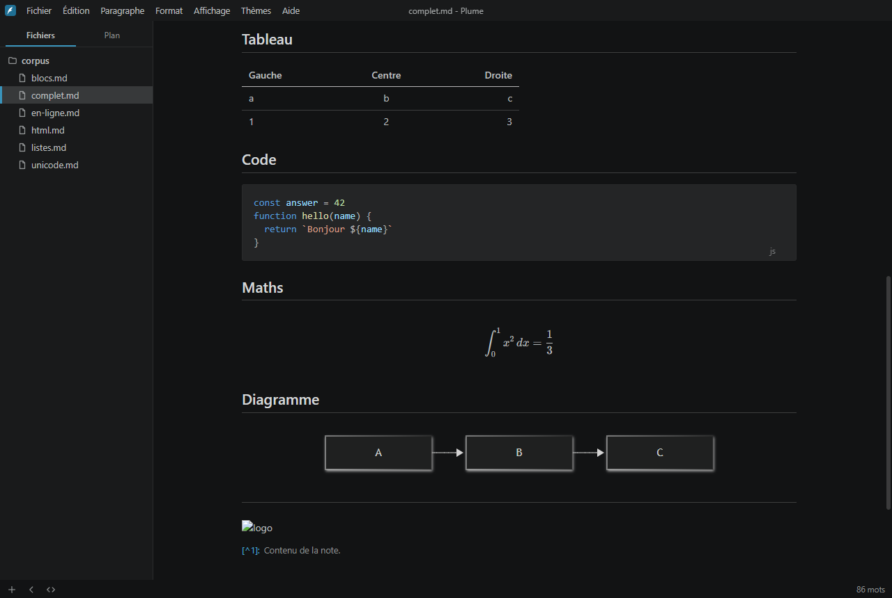
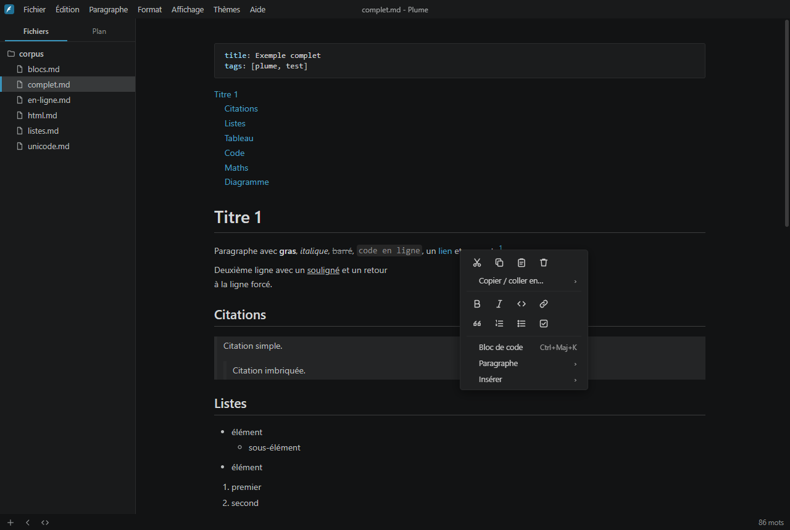

<p align="center">
  
</p>

<h1 align="center">Plume</h1>

<p align="center">
  Éditeur Markdown WYSIWYG pour Windows : on écrit du Markdown, on voit le résultat.<br>
  Les marqueurs apparaissent seulement là où se trouve le curseur.
</p>

<p align="center">
  
</p>

## Pourquoi Plume

- **Rendu en direct.** Titres, listes, tableaux, code coloré, formules et diagrammes
  s'affichent pendant la frappe. Les marqueurs `**`, `#` et `[…](…)` réapparaissent quand le
  curseur entre dans l'élément.
- **Markdown intact.** Le fichier reste du Markdown standard. Un passage par le mode source
  (Ctrl+/) ne modifie pas une ligne qu'on n'a pas touchée. Les fins de ligne LF ou CRLF sont
  conservées.
- **Pensé pour écrire.** Mode focus, mode machine à écrire, colonne de texte réglable à la
  souris, thème sombre lisible.
- **Local.** Pas de compte, pas de réseau. Réglages dans `%APPDATA%\Plume`, ou à côté de l'exe
  pour la version portable.

## Fonctions

| | |
| --- | --- |
| **Écriture** | titres, gras, italique, souligné, barré, code, liens, images, notes, citations, listes et tâches cliquables, règles |
| **Blocs** | code coloré (```` ```lang ```` + Entrée), tableaux (`\|a\|b\|` + Entrée ou Ctrl+T), formules KaTeX (`$$`), diagrammes Mermaid, table des matières `[TOC]`, en-tête YAML |
| **Navigation** | barre latérale Fichiers / Plan / Recherche dans le dossier, ouverture rapide floue (Ctrl+P), rechercher et remplacer |
| **Affichage** | mode source (Ctrl+/), focus (F8), machine à écrire (F9), plein écran (F11), zoom, thèmes Dark 2026, Clair et Papier |
| **Export** | HTML (avec ou sans styles), PDF, impression |

### Bloc de code en un clic

L'entrée **Bloc de code** (Ctrl+Maj+K) est au premier niveau du clic droit.

- Sur une ligne vide, elle la transforme en bloc de code.
- Sinon, elle insère un bloc juste en dessous et y place le curseur.

<p align="center"></p>

### Largeur de la colonne

Deux poignées encadrent le texte.

- **Glisser une poignée** : la colonne s'élargit ou se rétrécit des deux côtés à la fois.
- **Amener une poignée au bord** : la colonne passe en pleine largeur.
- **Double-cliquer sur une poignée** : bascule entre pleine largeur et largeur précédente.

La largeur est mémorisée. On peut aussi la saisir dans **Préférences ▸ Apparence**, en pixels,
en pourcentage ou en pleine largeur.

### Raccourcis utiles

| Action | Raccourci | Action | Raccourci |
| --- | --- | --- | --- |
| Titre 1 à 6 | Ctrl+1 … Ctrl+6 | Mode source | Ctrl+/ |
| Paragraphe | Ctrl+0 | Barre latérale | Ctrl+Maj+L |
| Gras / italique / souligné | Ctrl+B / I / U | Plan | Ctrl+Maj+1 |
| Lien | Ctrl+K | Recherche dans le dossier | Ctrl+Maj+F |
| Bloc de code | Ctrl+Maj+K | Ouverture rapide | Ctrl+P |
| Bloc de formule | Ctrl+Maj+M | Préférences | Ctrl+, |
| Tableau | Ctrl+T | Focus / machine à écrire | F8 / F9 |

La liste complète est dans **Aide ▸ Raccourcis clavier**.

## Installation

Compiler (voir plus bas), puis prendre l'un des fichiers de `dist/` :

- **`Plume-Setup-<version>.exe`** : installateur. Il permet de choisir le dossier, crée les
  raccourcis Bureau et menu Démarrer et associe les fichiers `.md`.
- **`Plume-<version>-portable.exe`** : rien à installer. Les réglages vont dans un dossier
  `data\` à côté de l'exe, ce qui permet de l'emporter sur une clé USB.

Les exécutables ne sont pas signés : Windows SmartScreen peut demander une confirmation au
premier lancement.

**Mise à jour.** Plume ne se met pas à jour tout seul. Pour passer à une nouvelle version :

- **version installée** : lancer le nouvel installateur, qui remplace l'ancienne version ;
- **version portable** : remplacer l'exe.

Les réglages sont conservés dans les deux cas.

## Développement

Prérequis : Node.js 24 et pnpm 11.

```bash
pnpm install
pnpm dev
```

Si Electron ne démarre pas au premier lancement, télécharger son binaire :

```bash
node node_modules/electron/install.js
```

| Commande | Rôle |
| --- | --- |
| `pnpm dev` | lance l'application avec rechargement à chaud |
| `pnpm test` | tests unitaires, dont l'aller-retour Markdown sans perte sur le corpus `tests/corpus` |
| `pnpm test:e2e` | compile puis lance les tests de bout en bout Playwright |
| `pnpm typecheck` | vérification TypeScript |
| `pnpm build:win` | installateur NSIS et exe portable dans `dist/` |
| `pnpm icon` | régénère les icônes depuis `app/renderer/src/assets/plume.svg` |
| `pnpm licenses:file` | régénère `THIRD_PARTY_LICENSES` |

```
app/main       processus principal Electron (fichiers, fenêtres, export PDF)
app/preload    pont sécurisé entre l'interface et le système
app/renderer   interface : éditeur Milkdown/ProseMirror, CodeMirror 6 pour le code et le mode source
app/shared     types et préférences communs
tests          corpus Markdown, tests unitaires (Vitest) et de bout en bout (Playwright)
```

L'interface est en français. Les textes sont dans `app/renderer/src/i18n/`, avec une version
anglaise.

## Limites connues

- Pas encore implémentés :
  - complétion des émojis `:nom:` ;
  - surlignage `==…==`, indices et exposants ;
  - encadrés d'alerte ;
  - collage d'une image depuis le presse-papiers (le glisser-déposer de fichiers fonctionne) ;
  - export Word via Pandoc.
- L'option « formules en ligne » s'applique au prochain document ouvert.
- Les diagrammes Mermaid utilisent la disposition `dagre`. La disposition `elk` est exclue
  parce que sa bibliothèque est sous licence EPL-2.0, non permissive.

## Licences

Code de Plume : MIT. Les bibliothèques embarquées sont sous licences permissives (MIT, ISC, BSD,
Apache-2.0). Elles sont listées avec leurs textes de licence dans `THIRD_PARTY_LICENSES`.
