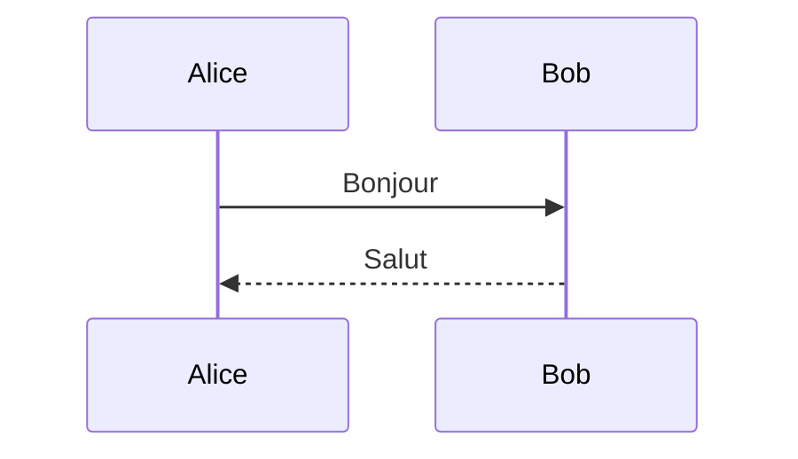

# Blocs

> Une citation
> sur deux lignes.

> Citation avec liste :
>
> - a
> - b

```python
def bonjour(nom):
    return f"Bonjour {nom}"
```

```
bloc sans langue
  avec indentation
```



$$
E = mc^2
$$

| Nom | Valeur |
| --- | ------ |
| a   | 1      |

---

Paragraphe final avec une note[^note].

[^note]: Texte de la note.
