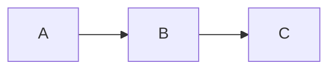

[TOC]

# Titre 1

Paragraphe avec **gras**, *italique*, ~~barré~~, `code en ligne`, un [lien](https://example.com "titre") et une note[^1].

Deuxième ligne avec un <u>souligné</u> et un retour\
à la ligne forcé.

## Citations

> Citation simple.
>
> > Citation imbriquée.

## Listes

- élément
  - sous-élément
- élément

1. premier
2. second

- [ ] à faire
- [x] fait

## Tableau

| Gauche | Centre | Droite |
| :----- | :----: | -----: |
| a      |    b   |      c |
| 1      |    2   |      3 |

## Code

```js
const answer = 42
function hello(name) {
  return `Bonjour ${name}`
}
```

## Maths

$$
\int_0^1 x^2\,dx = \frac{1}{3}
$$

## Diagramme



***


[^1]: Contenu de la note.
